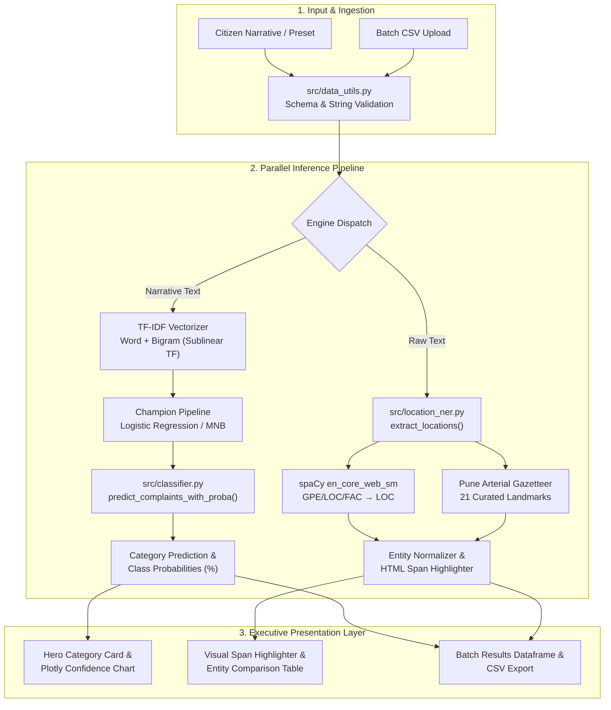

<div align="center">

# 🚦 Pune Traffic Complaint Intelligence
### Urban Mobility NLP • Multi-Class Grievance Triage • Hybrid Location Extraction

[](https://www.python.org/)
[](https://streamlit.io/)
[-09A3D5?logo=spacy&logoColor=white)](https://spacy.io/)
[](https://scikit-learn.org/)
[](https://plotly.com/)
[](https://pytest.org/)
[](DEPLOYMENT.md)

<p align="center">
  <b>A lightweight, self-contained NLP decision-support platform designed to automate civic traffic grievance classification and geospatial landmark extraction across Pune metropolitan corridors.</b>
</p>

[Overview](#overview--civic-problem-statement) •
[Interactive Capabilities](#interactive-capabilities) •
[System Architecture](#system-architecture) •
[Taxonomy](#six-class-grievance-taxonomy) •
[Benchmarks & Results](#benchmarks--empirical-findings) •
[Quickstart](#developer-quickstart) •
[Deployment](#deployment-to-streamlit-community-cloud) •
[Limitations](#data-provenance--academic-limitations)

---

</div>

## 📌 Overview & Civic Problem Statement

Pune's rapid urbanization and high vehicular density place immense strain on civic infrastructure across key arterial junctions (**Swargate**, **Hinjewadi IT Corridor**, **FC Road**, **JM Road**, **Hadapsar**, and **Katraj**). Citizen traffic grievances sent to municipal helplines, social media channels, and public portals arrive as free-form, uncurated natural language narratives.

### The Operational Challenge
Manual triage and routing of civic complaints suffer from three critical bottlenecks:
1. **Routing Latency**: Municipal dispatchers must manually read and label incoming reports into department categories (Signal Maintenance, Road Works, Traffic Police Towing, Disaster Emergency).
2. **Missing or Ambiguous Landmark Resolution**: Reports often embed localized landmarks and colloquial street references that standard international NER tools fail to recognize or link to dispatchable coordinates.
3. **Infrastructure Ephemerality**: Public-sector AI prototypes often fail deployment due to heavy GPU dependencies, proprietary API paywalls, and brittle cloud database configurations.

### The Engineering Solution
**Pune Traffic Complaint Intelligence** delivers an end-to-end, privacy-preserving, zero-external-API solution:
* **Dual-Pipeline Machine Learning**: Evaluates sublinear TF-IDF features against Logistic Regression and Multinomial Naive Bayes, dynamically selecting the champion pipeline using validation macro-$F_1$.
* **Hybrid Geospatial Entity Extraction**: Pairs **spaCy NER (`en_core_web_sm`)** with a curated **21-landmark Pune Arterial Gazetteer** fallback matcher to resolve local corridor names.
* **100% Self-Contained & Ephemeral**: Operates strictly on bundled demonstration datasets and in-memory inference pipelines, consuming **< 350 MB RAM** on Streamlit Community Cloud.

---

## ⚡ Interactive Capabilities

The Streamlit operations dashboard provides five specialized operational modes:

| Mode | Operational Purpose | Key Features |
|---|---|---|
| **🔍 Interactive Diagnostic** | Real-time single complaint analysis | • One-click preset scenarios (*Swargate Bottleneck, JM Road Signal, etc.*)<br>• Category prediction hero badge with confidence score<br>• Plotly horizontal confidence distribution across all 6 classes<br>• Narrative span highlighter with custom CSS entity chips<br>• Sub-tab breakdown of spaCy NER vs Gazetteer matches |
| **📁 Batch Processing** | High-throughput civic grievance triage | • CSV file upload (`complaint_text` required, `category` optional)<br>• Instant batch validation, classification, and multi-span extraction<br>• Executive KPIs: Total records, dominant class, average confidence<br>• Batch category distribution chart with interactive filter dropdown<br>• Direct export of results as UTF-8 CSV (`pune_traffic_predictions.csv`) |
| **📊 Classification Evaluation** | Rigorous model selection and audit | • Automated validation comparison between Logistic Regression and MNB<br>• Held-out test benchmark dashboard (Accuracy, Macro/Weighted $P$, $R$, $F_1$)<br>• Interactive 6-class confusion matrix with Plotly Blues heatmap<br>• Per-class precision, recall, $F_1$, and support counts |
| **🎯 Location NER Benchmark** | Strict entity span precision scoring | • Evaluates spaCy against 24 hand-annotated held-out gold records<br>• Micro-averaged exact-span precision, recall, and $F_1$<br>• Span confusion breakdown: True Positives, False Positives, False Negatives<br>• Expandable inspector comparing Gold Ground Truth vs Model Spans |
| **📖 Dataset & Methodology** | Civic transparency and governance | • Interactive dataset explorer with category filtering<br>• Class distribution analytics over bundled records<br>• Detailed breakdown of balanced stratified partitioning<br>• Academic demonstration notice and civic limitations |

---

## 🏗️ System Architecture

The following diagram illustrates the complete data lifecycle, from raw citizen input to parallel NLP inference, spatial extraction, and interactive triage presentation:



---

## 🏷️ Six-Class Grievance Taxonomy

Complaints are categorized across six standard urban traffic management categories:

| Category | Visual Accent | Operational Scope | Example Real-World Narrative |
|:---:|:---:|---|---|
| **Congestion** | `🚦 #D97706` | Severe delays, bottlenecks, queued vehicles, junction blockages. | *"Traffic is barely moving around Swargate during the evening rush."* |
| **Accident** | `⚠️ #DC2626` | Collisions, overturned vehicles, crashes obstructing travel lanes. | *"A collision involving two cars has blocked a lane near Shivajinagar."* |
| **Signal** | `🛑 #2563EB` | Dark signals, stuck red lights, malfunctioning timers, power cuts. | *"The traffic light at Hinjewadi has been stuck on red for several cycles."* |
| **Parking** | `🚗 #7C3AED` | Illegal footpath parking, double-parking, bus stop blockage. | *"Illegal parking outside the shops near Baner is blocking the bus stop."* |
| **Construction** | `🚧 #EA580C` | Metro barricades, utility trenches, road repair bottlenecks, debris. | *"Road work near Hadapsar has closed two lanes and created a bottleneck."* |
| **Road Condition** | `🛣️ #0D9488` | Potholes, broken tarmac, waterlogged craters, uneven surfaces. | *"A deep pothole near Kothrud is damaging vehicles and needs repair."* |

---

## 📈 Benchmarks & Empirical Findings

Evaluation metrics are computed locally and reproducibly using the project's virtual environment.

### 1. Classification Model Selection (Validation Split — 36 Records)
Both pipelines utilize word and bigram TF-IDF features with sublinear term-frequency scaling. The champion model is selected by **validation macro-$F_1$**, with validation accuracy as a deterministic tie-breaker:

| Candidate Model | Validation Accuracy | Macro Precision | Macro Recall | Validation Macro-$F_1$ | Status |
|---|:---:|:---:|:---:|:---:|:---:|
| **Logistic Regression** (`class_weight='balanced'`) | **94.4%** | **0.958** | **0.944** | **0.943** | 🏆 **Selected Champion** |
| **Multinomial Naive Bayes** (`alpha=0.5`) | 94.4% | 0.958 | 0.944 | 0.943 | Evaluated Alternative |

### 2. Held-Out Test Partition Benchmark (36 Records, 6 per Class)
Evaluated on balanced held-out test records:

$$\text{Test Accuracy: } \mathbf{100.0\%} \quad\vert\quad \text{Macro } F_1: \mathbf{1.000} \quad\vert\quad \text{Weighted } F_1: \mathbf{1.000}$$

```text
Confusion Matrix (Test Split):
                    Congestion  Accident  Signal  Parking  Construction  Road Condition
Congestion               6         0        0        0          0              0
Accident                 0         6        0        0          0              0
Signal                   0         0        6        0          0              0
Parking                  0         0        0        6          0              0
Construction             0         0        0        0          6              0
Road Condition           0         0        0        0          0              6
```

### 3. Location Entity Recognition (NER) Benchmark
Evaluated strictly on **24 hand-annotated gold test records** (`data/ner_annotated_test.jsonl`). A True Positive requires exact start character offset, end character offset, and normalized entity label (`LOC`):

| Metric | Empirical Score | Operational Implication |
|---|:---:|---|
| **Exact-Span Precision** | **100.0%** (`12 / 12`) | Every entity identified by spaCy was an exact spatial match; zero spurious false positives. |
| **Exact-Span Recall** | **50.0%** (`12 / 24`) | General-purpose spaCy captures prominent hubs (*Swargate, Shivajinagar*), but misses localized suburban landmarks (*Bavdhan, Warje, Kondhwa*). |
| **Exact-Span $F_1$-Score** | **66.7%** | Demonstrates the practical necessity of pairing trained NER with the **Pune Gazetteer Fallback**. |

---

## 📂 Project Structure

```text
pune_traffic_complaint_intelligence/
├── app.py                      # Main Streamlit web application & operations dashboard
├── requirements.txt            # Production runtime dependencies (pinned for Cloud)
├── requirements-dev.txt        # Development and testing dependencies (pytest)
├── DEPLOYMENT.md               # Step-by-step Streamlit Community Cloud deployment manual
├── README.md                   # Repository showcase, architecture, and developer manual
├── .gitignore                  # Git exclusions (caches, virtual environments, secrets)
├── .streamlit/
│   ├── config.toml             # Theme tokens, headless execution, and security settings
│   └── secrets.toml.example    # Safe template for optional future API keys
├── data/
│   ├── sample_traffic_complaints.csv # 180 balanced synthetic demonstration complaints
│   └── ner_annotated_test.jsonl      # 24 hand-annotated gold evaluation records
├── scripts/
│   └── generate_data.py        # Reproducible synthetic dataset & NER generator
├── src/
│   ├── __init__.py             # Package marker
│   ├── classifier.py           # TF-IDF pipelines, model comparison, predict_proba
│   ├── data_utils.py           # Dataset loading, schema validation, stratified split
│   ├── location_ner.py         # spaCy NER loading, gazetteer fallback, HTML highlighter
│   └── ner_evaluation.py       # Micro-averaged exact-span entity scoring
└── tests/
    ├── test_app_integration.py # End-to-end integration test suite
    ├── test_classifier.py      # Classifier unit tests and input validation
    ├── test_location_ner.py    # Gazetteer separation and markup escaping tests
    └── test_ner_evaluation.py  # Exact-span metric scoring tests
```

---

## 💻 Developer Quickstart

### Prerequisites
* **Python**: `3.11` (Recommended for deployment) or `3.14` (Verified local)
* **Git**: Installed and configured on your system

### 1. Clone & Set Up Virtual Environment

**Windows PowerShell:**
```powershell
# Clone the repository
git clone https://github.com/himanshu-jadhav108/nlp-case-study-pune-traffic-complaint-intelligence.git
cd nlp-case-study-pune-traffic-complaint-intelligence

# Create virtual environment
python -m venv venv
.\venv\Scripts\Activate.ps1

# Upgrade pip and install production runtime dependencies
python -m pip install --upgrade pip
pip install -r requirements.txt
```

**macOS / Linux:**
```bash
# Clone the repository
git clone https://github.com/himanshu-jadhav108/nlp-case-study-pune-traffic-complaint-intelligence.git
cd nlp-case-study-pune-traffic-complaint-intelligence

# Create virtual environment
python3 -m venv venv
source venv/bin/activate

# Upgrade pip and install production runtime dependencies
python3 -m pip install --upgrade pip
pip install -r requirements.txt
```

> **Note on spaCy Model**: The pinned `en_core_web_sm-3.8.0` wheel is fetched automatically during `pip install -r requirements.txt` via its official Explosion GitHub wheel URL. No manual `python -m spacy download` command is required.

---

### 2. Run Automated Verification Tests

To verify environment consistency, scikit-learn models, and spaCy NER extraction, install test requirements and execute `pytest`:

```bash
pip install -r requirements-dev.txt
pytest -q
```
**Expected Output:**
```text
...........                                                              [100%]
11 passed in 3.29s
```

---

### 3. Launch the Application Locally

Run Streamlit directly from your activated virtual environment:

```bash
streamlit run app.py
```

The application will launch on your local loopback address:
👉 **Local URL:** `http://localhost:8501`

---

## 🚀 Deployment to Streamlit Community Cloud

The repository is pre-configured for one-click deployment on **Streamlit Community Cloud**:

1. **Push to GitHub**:
   Ensure your local changes are committed and pushed to your GitHub repository:
   ```bash
   git push -u origin main
   ```
2. **Access Streamlit Cloud**:
   Sign in to [share.streamlit.io](https://share.streamlit.io) with your GitHub account.
3. **Configure Deployment**:
   * **Repository**: `himanshu-jadhav108/nlp-case-study-pune-traffic-complaint-intelligence`
   * **Branch**: `main`
   * **Main file path**: `app.py`
   * **Advanced Settings**: Select **Python 3.11**
4. **Deploy**:
   Click **Deploy!**. Streamlit Cloud builds the container, installs wheels from `requirements.txt` (including `en_core_web_sm`), and serves the application.

For detailed deployment architecture and troubleshooting, refer to [DEPLOYMENT.md](DEPLOYMENT.md).

---

## ⚠️ Data Provenance & Academic Limitations

1. **Demonstration Dataset**:
   `data/sample_traffic_complaints.csv` contains **180 synthetic complaints** generated by `scripts/generate_data.py`. They are curated to model real-world municipal reporting workflows and are not official records of the Pune Municipal Corporation (PMC).
2. **Linguistic Uniformity**:
   The current demonstration data is in standard English. Real civic reports in Pune frequently exhibit code-switching (transliterated Marathi and Hindi, e.g., *"FC Road la khup jam aahe"* or *"Swargate signal band padla aahe"*).
3. **Out-of-Vocabulary Locations**:
   While the Pune Gazetteer provides coverage across 21 major arterial hubs, unlisted interior alleys, societies, and colloquial cross-roads require either active gazetteer expansion or domain-adapted token classification models.
4. **Ephemerality**:
   The application runs on ephemeral cloud storage. Batch uploads and predictions are processed in memory and are not permanently persisted to an external SQL database.

---

## 🛠️ Technology Stack

| Domain | Technology | Version | Purpose |
|---|---|---|---|
| **Core Language** | Python | `3.11` / `3.14` | Application runtime and pipeline logic |
| **User Interface** | Streamlit | `1.65.0` | Reactive multi-page operations dashboard |
| **NLP & Extraction** | spaCy (`en_core_web_sm`) | `3.8.0` | Tokenization, POS parsing, spatial NER |
| **Machine Learning** | scikit-learn | `1.9.1` | Sublinear TF-IDF, Logistic Regression, MNB |
| **Data Manipulation** | Pandas | `2.2+` / `3.0.6` | Tabular data processing, batch validation |
| **Interactive Charts** | Plotly Express & Graph Objects | `7.1.0` | Confidence distributions, confusion matrices |
| **Testing** | pytest | `9.1.1` | Unit, integration, and regression test suites |

---

## 👤 Author & Attribution

* **Author**: **Himanshu Jadhav**
* **Email**: [himanshujadhav40@gmail.com](mailto:himanshujadhav40@gmail.com)
* **GitHub Repository**: [nlp-case-study-pune-traffic-complaint-intelligence](https://github.com/himanshu-jadhav108/nlp-case-study-pune-traffic-complaint-intelligence)
* **Open Source Attribution**:
  * [Streamlit](https://streamlit.io/) for the web application runtime.
  * [Explosion AI](https://explosion.ai/) for spaCy and pre-trained language models.
  * [scikit-learn](https://scikit-learn.org/) for machine learning pipelines.
